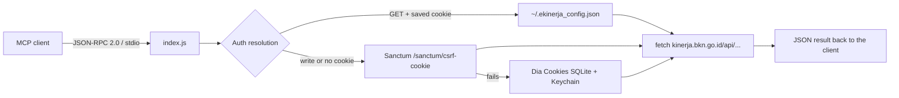

# e-Kinerja MCP Server

[](https://github.com/dendyadinirwana/ekinerja-bkn-mcp/actions/workflows/ci.yml)
[](https://github.com/dendyadinirwana/ekinerja-bkn-mcp/actions/workflows/release.yml)
[](https://nodejs.org)
[](#design-notes)

A dependency-free [Model Context Protocol](https://modelcontextprotocol.io) server for **e-Kinerja BKN** (`kinerja.bkn.go.id`). It exposes the SKP, RHK, Renaksi, and daily-activity endpoints as MCP tools over stdio, so any MCP-capable assistant can read and file your daily performance report without leaving the chat.

> Official government service, unofficial client. This project is not affiliated with or endorsed by BKN.

---

## Features

- **8 tools** covering the daily-activity workflow end to end: profile check, SKP, RHK, Renaksi, read/add/delete daily progress.
- **Zero runtime dependencies** — plain Node.js standard library, one file, no build step.
- **JSON-RPC 2.0 over stdio** (`protocolVersion: 2024-11-05`), compatible with any MCP client.
- **Automatic cookie acquisition** on macOS: reads and decrypts the e-Kinerja session from the Dia browser profile, or falls back to a fresh Laravel Sanctum CSRF cookie.
- **Local-only credential storage** in `~/.ekinerja_config.json`; nothing is sent anywhere except the e-Kinerja API.

## Requirements

| Requirement | Notes |
|---|---|
| Node.js **18+** | Uses global `fetch`. |
| macOS *(optional)* | Only for auto-cookie extraction from Dia; other platforms can use a Bearer token instead. |
| `sqlite3` CLI | Only for the Dia cookie path. Preinstalled on macOS. |
| An e-Kinerja BKN account | You must be able to log in at `kinerja.bkn.go.id`. |

## Quick start

```bash
git clone git@github.com:dendyadinirwana/ekinerja-bkn-mcp.git
cd ekinerja-bkn-mcp
node --check index.js
npm test          # offline protocol handshake, no API calls
```

There is nothing to install — the server has no dependencies.

## Configuration

### Register the server with an MCP client

Point your client at the absolute path of `index.js`:

```json
{
  "mcpServers": {
    "ekinerja-bkn": {
      "command": "node",
      "args": ["/absolute/path/to/ekinerja-bkn-mcp/index.js"]
    }
  }
}
```

For a repo-local install, `args` can be `["./index.js"]` with `cwd` set to the checkout. The same block works for Claude Desktop, Claude Code, Codex, OpenCode, and other stdio MCP clients.

### Authenticate

Two paths, in this order:

1. **Bearer token (all platforms).** Sign in at `kinerja.bkn.go.id`, copy `localStorage.token` from DevTools, then call `ekinerja_set_token`. The value is written to `~/.ekinerja_config.json`.
2. **Dia cookies (macOS).** With an active Dia session on `kinerja.bkn.go.id`, the server copies the Cookies SQLite DB to a temp file, unlocks the `Dia Safe Storage` Keychain item, decrypts the AES-128-CBC values, and reuses the session. No manual step.

Verify with `ekinerja_status`. A `200` returns your short profile; anything else means the session is missing or expired.

`~/.ekinerja_config.json` is plain text. Keep it readable by you only:

```bash
chmod 600 ~/.ekinerja_config.json
```

## Tools

| Tool | Arguments | What it does |
|---|---|---|
| `ekinerja_status` | — | Checks the session and returns the logged-in employee's short profile. |
| `ekinerja_set_token` | `token` | Stores a Bearer JWT from `localStorage.token`. |
| `ekinerja_list_skp` | `date` | Lists active SKP for a date (`YYYY-MM-DD`, defaults to today). |
| `ekinerja_list_rhk` | `skp_id` | Lists the RHK belonging to one SKP. |
| `ekinerja_list_renaksi` | `skp_id`, `periode_id` | Lists Renaksi for a SKP and period. |
| `ekinerja_get_daily_activities` | `skp_id`, `date` | Reads existing daily activity logs for a date. |
| `ekinerja_add_daily_activity` | `skp_id`, `date`, `kegiatan`, `start`, `end` + optional `rhk_id`, `rhk_bagian`, `renaksi_id`, `periode_id`, `indikator_id`, `satuan_activity`, `realisasi_activity`, `is_selesai`, `bukti_eviden` | Files a daily progress entry. Defaults: `realisasi_activity: 1`, `satuan_activity: "Kegiatan"`, `is_selesai: "0"`. |
| `ekinerja_delete_daily_activity` | `activity_id` | Deletes a daily entry filed by mistake. |

### Example session

```text
user      > Cek SKP aktif hari ini, lalu tampilkan RHK-nya.
assistant > ekinerja_list_skp { "date": "2026-11-11" }
          > ekinerja_list_rhk { "skp_id": "<skp_id from ekinerja_list_skp>" }
          > ...
```

For a report, the usual flow is `ekinerja_list_skp` → `ekinerja_list_rhk` → `ekinerja_list_renaksi` → `ekinerja_add_daily_activity`.

## How it works



Endpoints used:

```text
GET    /api/pegawai/profil_singkat
GET    /api/daily_activity/list_skp?date=YYYY-MM-DD
GET    /api/daily_activity/{skp_id}/rhk
GET    /api/daily_activity/{skp_id}/renaksi?periode_id=...
GET    /api/daily_activity/harian?date=YYYY-MM-DD&skp_id=...
POST   /api/daily_activity
DELETE /api/daily_activity/{activity_id}
GET    /sanctum/csrf-cookie
```

Responses are passed through verbatim as pretty-printed JSON, so the assistant sees exactly what the API returned.

## Security

- Credentials live only in `~/.ekinerja_config.json` and the OS Keychain. They are never logged, printed, or committed; `.gitignore` blocks the config file and CI fails the build if it ever appears in git.
- The Dia cookie path reads a **copy** of the browser database in the temp directory and deletes it immediately after the query.
- The server writes to your real e-Kinerja record. `ekinerja_add_daily_activity` and `ekinerja_delete_daily_activity` change live data — review the entry before approving it in your client.
- Read-only by preference: grant the assistant read tools first (`status`, `list_*`, `get_*`) and enable the write tools deliberately.
- Do not commit `~/.ekinerja_config.json`, HAR captures, or screenshots containing a token. Revoke by logging out of e-Kinerja and clearing the file.

## CI and releases

| Workflow | Trigger | What it does |
|---|---|---|
| [`ci.yml`](.github/workflows/ci.yml) | push / PR to `main`, manual | Syntax check plus the stdio protocol smoke test on Node 18, 20 and 22; a hygiene job that rejects committed credentials and unexpected dependencies. |
| [`release.yml`](.github/workflows/release.yml) | tag `v*.*.*`, manual | Re-runs the smoke test, checks the tag against `package.json`, builds a zip bundle and publishes a GitHub release. |

Cut a release:

```bash
npm version 1.0.1 --no-git-tag-version
git commit -am "chore: release 1.0.1"
git tag v1.0.1
git push origin main --tags
```

## Troubleshooting

| Symptom | Cause and fix |
|---|---|
| `Autentikasi Belum Aktif (Status 401)` | Session expired. Call `ekinerja_set_token` with a fresh JWT, or sign in again in Dia. |
| `Status 419` on write | CSRF mismatch. The server refreshes Sanctum cookies on every write; retry once, then re-authenticate. |
| Dia cookies not found | Dia is not signed in to `kinerja.bkn.go.id`, or the Keychain prompt was declined. Use the token path instead. |
| `sqlite3: command not found` | Install the SQLite CLI, or use the token path. |
| Tool list empty in the client | The client cannot execute `node`, or the path in `args` is relative. Use an absolute path. |
| CI hygiene job fails | A credential or a dependency crept into the repo. Check `git ls-files` for `.ekinerja_config.json`. |

## Project layout

```text
.
├── index.js                 # server: tools, auth, JSON-RPC loop
├── package.json
├── test/smoke.mjs           # offline handshake + tools/list test
└── .github/workflows/
    ├── ci.yml
    └── release.yml
```

## Design notes

- **No dependencies, single file.** The server is meant to be copied into an MCP client config and left running; a lockfile and a `node_modules` tree would only add supply-chain surface.
- **No HTTP transport.** stdio keeps the session local and needs no port, tunnel, or auth shim in front of the server.
- **Pass-through responses.** Raw API JSON is returned instead of a normalized schema, so upstream field changes stay visible instead of being silently dropped.

## License

Private repository, all rights reserved. No license is granted for redistribution.
